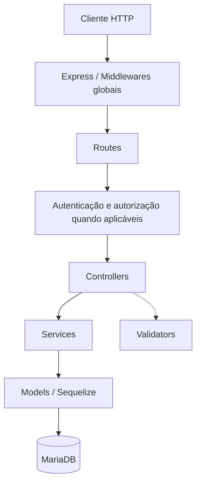
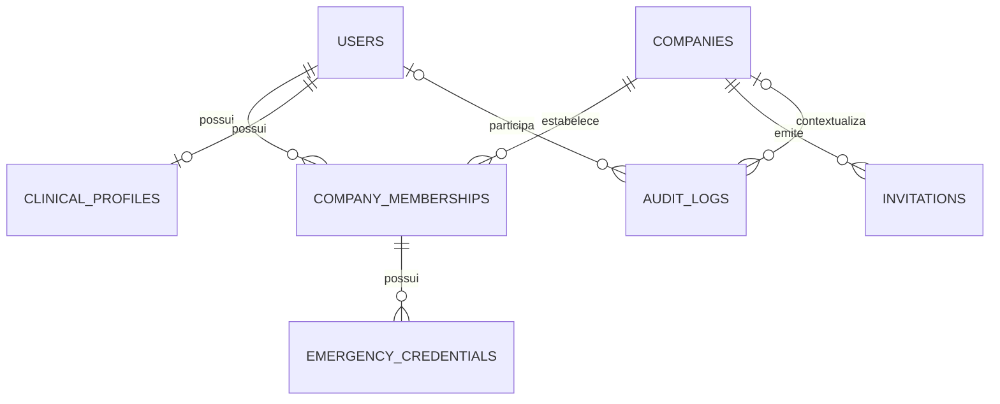

# VitalCode | Backend

**API REST para gestão de informações emergenciais e credenciais digitais de colaboradores em ambientes corporativos.**


## Visão geral

A VitalCode é uma plataforma voltada à gestão de informações essenciais de colaboradores, especialmente em empresas que desenvolvem atividades com exposição a riscos ocupacionais.

A solução centraliza o gerenciamento de vínculos profissionais, fichas clínicas individuais e credenciais emergenciais com QR Code. Em uma situação de emergência, a credencial permite consultar informações previamente cadastradas pelo colaborador, sem exigir uma conta na plataforma de quem realiza a consulta.

O backend foi desenvolvido com arquitetura multiempresa, controle de acesso baseado em papéis e vínculos, separação de responsabilidades e mecanismos de consistência transacional. A gestão administrativa é dissociada do conteúdo clínico, preservando a autonomia do usuário sobre sua ficha individual.

**Status:** funcionalidades centrais do backend do MVP implementadas e validadas em ambiente local. Frontend e integração em evolução.

## Funcionalidades

| Módulo | Recursos |
| --- | --- |
| Identidade e autenticação | Cadastro empresarial transacional, autenticação JWT, hash de senhas com Argon2id e consulta da identidade autenticada. |
| Gestão multiempresa | Autorização por vínculo e papel, listagem de empresas, pesquisa e consulta de funcionários. |
| Convites empresariais | Emissão de convites temporários, cadastro de convidados, listagem, aceitação por token ou ID, recusa e reativação de vínculos. |
| Ficha clínica | Criação, consulta e atualização individual, preenchimento progressivo e controle de completude. |
| Credenciais emergenciais | Emissão de até duas credenciais por vínculo, geração de QR Code, listagem de metadados e revogação individual. |
| Consulta emergencial | Acesso público mediante token válido, condicionado ao estado da credencial, da conta, da empresa, do vínculo e da ficha clínica. |
| Desligamento de funcionários | Desativação do vínculo e revogação definitiva das credenciais ativas em uma única transação. |
| Auditoria | Registro de emissão, revogação, consulta emergencial e desligamento. |

## Arquitetura

O backend adota uma arquitetura em camadas, com organização por domínio nos controllers, services e validators, e por responsabilidade nos middlewares.



| Camada | Responsabilidade |
| --- | --- |
| Routes | Contratos HTTP e composição de middlewares. |
| Controllers | Tratamento de requisições e respostas. |
| Services | Regras de negócio, operações de persistência e transações. |
| Validators | Validação de dados de entrada com Zod. |
| Middlewares | Autenticação, autorização, segurança HTTP, limites de requisições e tratamento de erros. |
| Models | Entidades relacionais e associações. |
| Migrations | Evolução versionada do esquema relacional. |
| Utils | Funções reutilizáveis de suporte à aplicação. |

### Modelo de domínio

A identidade do usuário é global, enquanto permissões e credenciais são determinadas pelo vínculo profissional correspondente. A ficha clínica é individual e não é duplicada entre empresas.



O diagrama representa os relacionamentos centrais do domínio. O esquema detalhado está disponível em [schema.dbml](docs/database/schema.dbml).

## Decisões de engenharia

### Isolamento multiempresa e autorização

A autenticação identifica o usuário globalmente. A autorização empresarial verifica, separadamente, a empresa solicitada, o vínculo ativo e o papel exigido pela operação. Consultas administrativas são restritas ao contexto autorizado e não retornam o conteúdo da ficha clínica.

### Credenciais revogáveis e proteção de tokens

Cada vínculo pode possuir até duas credenciais ativas, permitindo a utilização de um crachá principal e outro reserva. Os tokens são gerados criptograficamente e armazenados exclusivamente como hashes SHA-256.

O QR Code contém uma URL com o token original, disponibilizada na emissão. Durante a consulta, a API calcula o hash do token recebido e localiza a credencial correspondente. O token original não pode ser recuperado pela listagem de credenciais.

Credenciais revogadas não são reativadas. A substituição de um crachá exige uma nova emissão.

### Consistência transacional e concorrência

Operações críticas utilizam transações Sequelize, bloqueios de registros e validações de estado. O protocolo de bloqueio coordena operações concorrentes, incluindo emissão de credenciais e desligamento de funcionários.

No desligamento, a alteração do vínculo, a revogação das credenciais e os registros de auditoria são persistidos atomicamente. A conta global e a ficha clínica permanecem preservadas.

### Completude clínica

A ficha permite preenchimento progressivo. A emissão e a consulta emergencial dependem da validação dos campos essenciais. O tipo sanguíneo é opcional, e a completude não representa avaliação de aptidão ocupacional.

## Stack tecnológica

| Tecnologia | Aplicação |
| --- | --- |
| Node.js e JavaScript | Runtime e linguagem do backend |
| Express.js | API REST e middlewares HTTP |
| Sequelize | ORM, associações, migrations e transações |
| MariaDB | Persistência relacional |
| JWT e Argon2id | Autenticação e proteção de senhas |
| Zod | Validação de entrada |
| SHA-256 | Hash de tokens aleatórios |
| Helmet, CORS e express-rate-limit | Controles de segurança HTTP |
| Docker e Docker Compose | Ambiente de infraestrutura |
| Postman, DBeaver e dbdiagram.io | Validação e modelagem |

## Endpoints


| Método | Endpoint                                                      | Descrição                                 |
| ------ | ------------------------------------------------------------- | ----------------------------------------- |
| GET    | `/health`                                                     | Verificar disponibilidade da API          |
| POST   | `/companies/register`                                         | Cadastrar empresa e administrador inicial |
| POST   | `/auth/login`                                                 | Autenticar usuário                        |
| GET    | `/auth/me`                                                    | Consultar identidade autenticada          |
| GET    | `/companies/my`                                               | Listar empresas associadas                |
| GET    | `/companies/:companyId/employees`                             | Listar e pesquisar funcionários           |
| GET    | `/companies/:companyId/employees/:employeeId`                 | Consultar funcionário                     |
| GET    | `/companies/:companyId/employees/:employeeId/clinical-status` | Consultar completude clínica              |
| PATCH  | `/companies/:companyId/employees/:employeeId/deactivate`      | Desativar funcionário                     |
| POST   | `/companies/:companyId/invitations`                           | Criar convite                             |
| GET    | `/invitations/my`                                             | Listar convites pendentes                 |
| POST   | `/invitations/accept`                                         | Aceitar por token                         |
| POST   | `/invitations/:invitationId/accept`                           | Aceitar por ID                            |
| POST   | `/invitations/:invitationId/decline`                          | Recusar convite                           |
| POST   | `/clinical-profile/me`                                        | Criar ficha clínica                       |
| GET    | `/clinical-profile/me`                                        | Consultar ficha própria                   |
| PATCH  | `/clinical-profile/me`                                        | Atualizar ficha própria                   |
| GET    | `/clinical-profile/me/status`                                 | Consultar completude                      |
| POST   | `/companies/:companyId/credentials`                           | Emitir credencial própria                 |
| GET    | `/companies/:companyId/credentials`                           | Listar credenciais próprias               |
| GET    | `/emergency/:token`                                           | Consultar informações emergenciais        |

Os contratos de cadastro por convite e revogação individual também estão definidos nos arquivos de rotas em `src/routes/`.

Exemplo de pesquisa: `GET /companies/5/employees?search=João`.

## Estrutura do projeto

```
vitalcode-backend/
├── src/
│   ├── config/
│   ├── controllers/
│   │   ├── auth/
│   │   ├── clinicalProfile/
│   │   ├── companies/
│   │   ├── credentials/
│   │   ├── emergency/
│   │   ├── employees/
│   │   ├── invitations/
│   │   └── HealthController.js
│   ├── database/
│   │   ├── migrations/
│   │   └── index.js
│   ├── middlewares/
│   │   ├── auth/
│   │   ├── errors/
│   │   ├── rateLimit/
│   │   ├── security/
│   │   └── validators/
│   ├── models/
│   ├── routes/
│   ├── scripts/
│   ├── services/
│   │   ├── auth/
│   │   ├── clinicalProfile/
│   │   ├── companies/
│   │   ├── credentials/
│   │   ├── employees/
│   │   └── invitations/
│   ├── utils/
│   ├── validators/
│   │   ├── auth/
│   │   ├── clinicalProfile/
│   │   ├── companies/
│   │   └── invitations/
│   ├── app.js
│   └── server.js
├── docs/
│   ├── database/
│   │   ├── decisions.md
│   │   └── schema.dbml
│   └── architecture.md
├── tests/
├── .env.example
├── .gitignore
├── .sequelizerc
├── docker-compose.yml
├── package-lock.json
├── package.json
└── README.md

```

## Executando localmente

### Pré-requisitos

- Node.js 18 ou superior (com suporte a `fetch` nativo)
- npm
- Docker e Docker Compose

### Instalação

```bash
git clone https://github.com/Luiz-Mujalli/vitalcode-backend.git
cd vitalcode-backend
npm install
```

Crie o arquivo `.env` utilizando `.env.example` como referência. Configure a conexão com o MariaDB, o segredo JWT, a porta da API e `FRONTEND_URL`, utilizada na configuração de CORS e na geração de links emergenciais.

```bash
docker compose up -d
npx sequelize-cli db:migrate
npm run dev
```

Verifique a disponibilidade da API através de `GET /health`, na porta configurada no ambiente.

As rotas protegidas utilizam o cabeçalho `Authorization: Bearer <token>`.

## Segurança e privacidade

A implementação incorpora controles em diferentes camadas:

- Autenticação JWT, verificação de contas ativas e autorização por vínculo e papel.
- Hash de senhas com Argon2id e de tokens aleatórios com SHA-256.
- Integridade referencial, restrições de unicidade e transações em operações críticas.
- Helmet, política de CORS, rate limiting geral, de autenticação e emergencial.
- Limitação do corpo de requisições e tratamento de erros em JSON.
- Cabeçalhos `Cache-Control: no-store`, `X-Robots-Tag` e `Referrer-Policy` na consulta emergencial.
- Auditoria de operações sensíveis e minimização de informações retornadas pela API.

O acesso emergencial utiliza uma credencial de posse: qualquer pessoa que obtenha uma cópia válida do QR Code poderá consultar os dados disponibilizados. Esse mecanismo não verifica a identidade do socorrista. A revisão de logs, controles de infraestrutura, retenção de auditoria e adequação à LGPD integram a evolução de segurança da plataforma.

O MVP destina-se à demonstração com dados fictícios. A utilização de informações clínicas reais ou a dependência do sistema em atendimentos emergenciais exige validação técnica, jurídica e operacional adicional.

## Testes e validação

A validação funcional utiliza Postman, consultas ao MariaDB e scripts Node.js para cenários de concorrência e segurança HTTP.

| Área | Cenários verificados |
| --- | --- |
| Identidade | Cadastro, duplicidade, autenticação e autorização. |
| Multiempresa | Isolamento de consultas e restrições por papel. |
| Convites | Expiração, destinatário, reutilização, aceitação, recusa e reativação de vínculos. |
| Ficha clínica | Criação, atualização, completude e restrição de acesso administrativo. |
| Credenciais | Emissão, limite por vínculo, QR Code, consulta e revogação. |
| Desligamento | Desativação do vínculo, invalidação de credenciais e auditoria. |
| Segurança HTTP | Rate limiting, CORS, cabeçalhos, limites de corpo e respostas de erro. |
| Concorrência | Operações simultâneas de convites, emissão de credenciais e desligamento. |

No cenário concorrente de emissão e desligamento, a execução registrada retornou `403` para emissão e `200` para desligamento. A verificação do estado persistido complementa esse teste HTTP.

A estratégia de validação será ampliada com uma suíte automatizada de testes e integração contínua. Os testes locais não equivalem a uma auditoria de segurança.

## Roadmap

- Frontend React e integração com a API.
- Deploy com HTTPS e configuração de infraestrutura.
- Testes automatizados e integração contínua.
- Gestão de administradores e proteção do último responsável ativo.
- Entrega de convites por e-mail e verificação de propriedade do endereço.
- Upload de fotos e evolução dos controles de segurança, privacidade e observabilidade.

## Documentação técnica

- [Arquitetura da aplicação](docs/architecture.md)
- [Decisões de modelagem e persistência](docs/database/decisions.md)
- [Esquema relacional](docs/database/schema.dbml)

## Autor

Desenvolvido por [Luiz Mujalli](https://github.com/Luiz-Mujalli) — projeto autoral de portfólio, com foco em engenharia de software, desenvolvimento backend e arquitetura de aplicações full stack.
