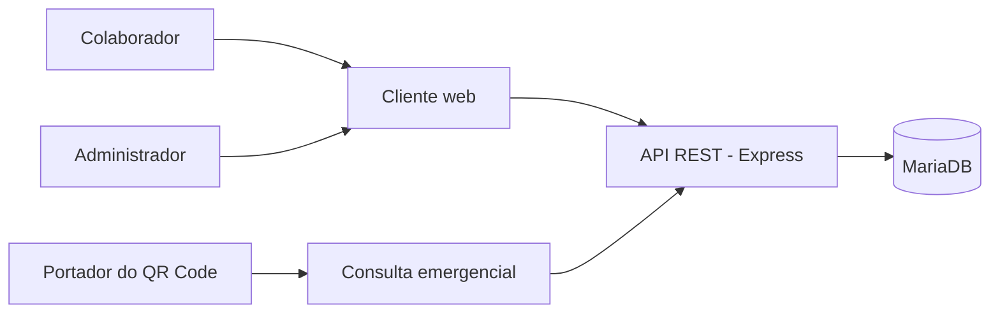
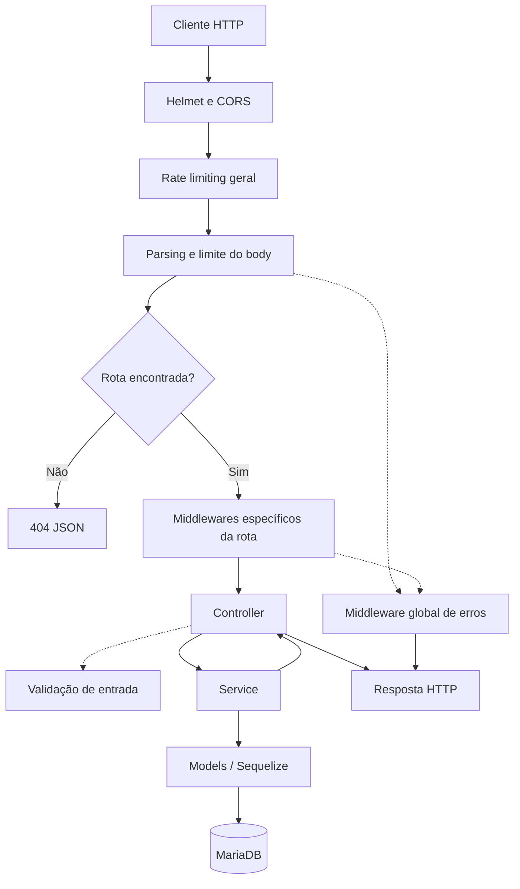
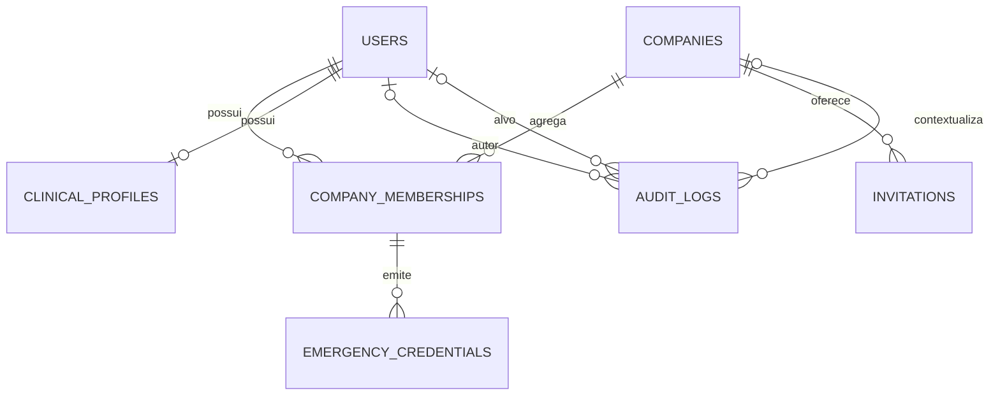
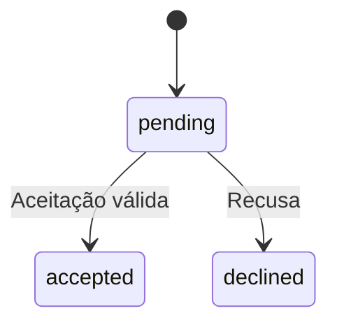
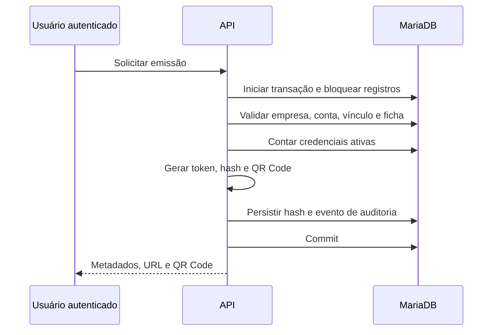

# VitalCode | Arquitetura de Software

**Arquitetura da API REST, modelo de domínio, consistência transacional e fronteiras de segurança.**

[Visão geral do produto](../README.md) · [Decisões de engenharia](database/decisions.md) · [Esquema relacional](database/schema.dbml)

## 1. Visão arquitetural

A VitalCode centraliza informações emergenciais de colaboradores e gerencia credenciais digitais vinculadas ao contexto profissional. O backend é estruturado como uma aplicação modular em camadas, com persistência relacional compartilhada e isolamento lógico entre empresas.

A arquitetura privilegia separação de responsabilidades, integridade dos dados, autorização contextual, minimização da exposição clínica e evolução incremental do domínio. As funcionalidades centrais do MVP estão implementadas e foram submetidas a validações locais.



O cliente web representa a fronteira de integração com o frontend React, cuja implementação constitui a próxima etapa do produto. A API concentra as regras de negócio e não depende da interface para aplicar autorização.

## 2. Stack tecnológica

| Tecnologia | Responsabilidade |
| --- | --- |
| Node.js e JavaScript | Runtime e implementação da aplicação |
| Express | Contratos HTTP e composição de middlewares |
| Sequelize | Mapeamento relacional, transações e locks |
| MariaDB | Persistência e integridade referencial |
| JWT e Argon2id | Autenticação e proteção de senhas |
| Node.js Crypto / SHA-256 | Geração e verificação de tokens aleatórios |
| Zod | Validação de entradas |
| QR Code | Representação da URL de acesso emergencial |
| Helmet, CORS, express-rate-limit | Controles de segurança HTTP |
| Docker Compose | Ambiente local de banco de dados |

## 3. Organização do código

A organização combina camadas técnicas com agrupamento por domínio. Controllers, services e validators são segmentados conforme as funcionalidades; middlewares são agrupados por responsabilidade transversal.

```text
src/
├── config/
├── controllers/
│   ├── auth/
│   ├── clinicalProfile/
│   ├── companies/
│   ├── credentials/
│   ├── emergency/
│   ├── employees/
│   ├── invitations/
│   └── HealthController.js
├── database/
│   ├── migrations/
│   └── index.js
├── middlewares/
│   ├── auth/
│   ├── errors/
│   ├── rateLimit/
│   ├── security/
│   └── validators/
├── models/
├── routes/
├── scripts/
├── services/
│   ├── auth/
│   ├── clinicalProfile/
│   ├── companies/
│   ├── credentials/
│   ├── employees/
│   └── invitations/
├── utils/
├── validators/
│   ├── auth/
│   ├── clinicalProfile/
│   ├── companies/
│   └── invitations/
├── app.js
└── server.js
```

| Componente | Responsabilidade |
| --- | --- |
| Routes | Definir endpoints e encadear middlewares específicos |
| Controllers | Adaptar requisições HTTP, acionar validações e services, construir respostas |
| Services | Executar regras de negócio e coordenar operações de persistência |
| Validators | Validar contratos de entrada com Zod e regras específicas |
| Middlewares | Aplicar autenticação, autorização, limites e tratamento de erros |
| Models | Representar entidades e associações do Sequelize |
| Migrations | Versionar tabelas, índices e restrições |
| Utils | Centralizar funções reutilizáveis, como completude clínica e tokens |
| Config | Centralizar parâmetros de infraestrutura |

`database/index.js` inicializa a conexão, registra os models e configura associações. `app.js` compõe a aplicação Express; `server.js` é seu ponto de inicialização.

## 4. Ciclo de uma requisição



A presença de autenticação, autorização e validação depende do contrato da rota. A consulta emergencial possui limitador próprio e é excluída do limitador geral. Controllers mantêm tratamentos locais de erro; o middleware global complementa os erros encaminhados pelo Express, incluindo JSON inválido e excesso de tamanho do corpo.

## 5. Modelo de domínio e isolamento multiempresa



| Entidade | Responsabilidade |
| --- | --- |
| `users` | Identidade global e estado da conta |
| `companies` | Contexto empresarial |
| `company_memberships` | Cargo, papel e estado do vínculo |
| `invitations` | Ingresso de colaboradores |
| `clinical_profiles` | Ficha individual, independente da empresa |
| `emergency_credentials` | Histórico de credenciais por vínculo |
| `audit_logs` | Eventos relevantes e contexto operacional |

O diagrama representa os relacionamentos centrais, não substituindo o esquema físico. A identidade global permite múltiplos vínculos empresariais. O isolamento é aplicado na camada de autorização e nas consultas contextualizadas; não corresponde a bancos separados por empresa.

## 6. Identidade e controle de acesso

A autenticação utiliza JWT assinado com HS256 e verifica a existência e o estado ativo da conta. Senhas são protegidas com Argon2id. A autenticação não depende de um vínculo ativo.

`authorizeCompany` valida o identificador empresarial, o estado da empresa, o vínculo ativo e os papéis permitidos. O contexto validado é disponibilizado em `req.company`. Operações críticas revalidam condições de negócio dentro da transação.

| Operação | Contexto exigido |
| --- | --- |
| Gerenciar funcionários e criar convites | Administrador ativo da empresa |
| Consultar ou atualizar ficha própria | Usuário autenticado e ativo |
| Emitir credencial própria | Admin ou employee com vínculo ativo e ficha completa |
| Listar ou revogar credenciais próprias | Vínculo autorizado e titularidade |
| Consultar informação emergencial | Posse de token válido e condições de acesso satisfeitas |

A gestão administrativa não retorna conteúdo clínico. A consulta de completude é distinta da consulta emergencial pública.

## 7. Fluxos de negócio

### 7.1. Cadastro empresarial

Empresa, usuário administrador inicial e vínculo são criados atomicamente. Falhas de validação ou persistência impedem a conclusão parcial do cadastro.

### 7.2. Convites empresariais

O administrador emite um convite temporário, cujo token aleatório é armazenado como hash SHA-256. Um convidado sem conta pode cadastrar-se; a criação da conta não equivale à aceitação do vínculo. Usuários autenticados podem listar convites pendentes, aceitar por token ou ID e recusar por ID.



O prazo de validade é verificado separadamente; a expiração não pressupõe uma atualização automática de status. A aceitação verifica o destinatário pelo e-mail da conta, a validade, a empresa e o estado do convite. Criação ou reativação do vínculo e aceitação ocorrem na mesma transação. O papel concedido é `employee`, definido pelo servidor. A verificação de propriedade do e-mail e a entrega real de convites são evoluções previstas.

### 7.3. Ficha clínica

A ficha é individual, com preenchimento progressivo e operações de criação, leitura, atualização e consulta de completude. A função `isClinicalProfileComplete` centraliza a regra de elegibilidade clínica.

São exigidos registros explícitos de alergias, medicamentos, doenças, cirurgias e nome e telefone do contato de emergência. Tipo sanguíneo é opcional. Valores ausentes não equivalem à declaração de ausência de condição clínica. Completude não constitui avaliação médica nem aptidão ocupacional.

### 7.4. Emissão de credenciais



Cada vínculo admite até duas credenciais ativas, destinadas ao uso principal e reserva. Ambas possuem tokens independentes. O token original integra a URL e não é persistido; somente seu hash é armazenado. A listagem retorna metadados, sem recuperar o QR Code original. Uma credencial perdida pode ser revogada e substituída, respeitando o limite.

### 7.5. Consulta emergencial

A rota pública recebe o token, valida seu formato, calcula o SHA-256 e busca a credencial correspondente. O acesso depende dos estados da credencial, conta, empresa, vínculo e completude da ficha. A resposta utiliza um conjunto explícito de informações essenciais e registra auditoria de acesso.

A posse do token é a condição de acesso, não uma comprovação de identidade ou de emergência. O QR Code não contém diretamente o conteúdo clínico. Uma cópia válida do código pode ser utilizada por terceiros enquanto permanecer ativa.

### 7.6. Desligamento e revogação

O administrador pode desativar vínculos de funcionários da própria empresa. A operação preserva a conta global e a ficha, desativa o vínculo, revoga as credenciais ativas, preenche `revoked_at` e registra auditoria na mesma transação. Uma recontratação não reativa credenciais antigas.

## 8. Consistência e concorrência

Operações críticas utilizam transações gerenciadas pelo Sequelize. Emissão de credenciais e desligamento utilizam `READ COMMITTED` e locks de atualização. O bloqueio da empresa antecede os demais registros nesses fluxos, coordenando operações concorrentes que seguem o mesmo protocolo.

| Cenário | Invariante |
| --- | --- |
| Emissão simultânea | No máximo duas credenciais ativas por vínculo |
| Aceitação e recusa concorrentes | Apenas uma transição válida do convite pendente |
| Emissão e desligamento concorrentes | Vínculo inativo sem credenciais ativas após conclusão do desligamento |
| Falha durante alteração e auditoria transacional | Rollback das alterações da operação |

O limite de credenciais é uma regra transacional da aplicação, não uma restrição de unicidade do banco. Locks precisam ser respeitados por todos os fluxos de escrita relevantes. A serialização por empresa simplifica a coordenação, mas pode aumentar contenção sob carga.

## 9. Segurança e observabilidade

| Controle | Aplicação |
| --- | --- |
| Argon2id, JWT e autorização contextual | Identidade e permissões |
| SHA-256 de tokens aleatórios | Redução da exposição de credenciais persistidas |
| Helmet e CORS | Cabeçalhos e política de origens do navegador |
| Rate limiting | Limites gerais, autenticação e consulta emergencial |
| Limite de body e validação | Redução de entradas inválidas e excessivas |
| `Cache-Control: no-store` | Respostas sensíveis, conforme a rota |
| `X-Robots-Tag` e `Referrer-Policy` | Redução de indexação e propagação de referências na consulta emergencial |
| Auditoria | Emissão, revogação, desligamento e consulta emergencial |

Os eventos de auditoria podem identificar empresa, autor, alvo, ação, recurso e metadados operacionais. A consulta pública não autentica o autor. Senhas, tokens originais e conteúdo clínico não devem integrar logs. A desativação do logging SQL e a sanitização dos erros são verificações de encerramento; não se presume que já tenham sido concluídas.

## 10. Validação e evolução operacional

Os fluxos centrais foram validados localmente com Postman, consultas ao MariaDB e scripts Node.js. O teste concorrente de emissão e desligamento apresentou HTTP 403 e 200, respectivamente. A verificação final do estado persistido deve confirmar vínculo inativo e ausência de credenciais ativas. Testes pontuais não substituem cobertura automatizada abrangente.

O roadmap técnico inclui integração React, deploy com HTTPS e configuração de proxy, armazenamento compartilhado para rate limiting quando necessário, gestão de administradores, entrega e verificação de e-mail, upload de fotos, testes automatizados e observabilidade estruturada.

Antes de tratar dados clínicos reais, são necessárias avaliações de segurança, privacidade, disponibilidade e LGPD, incluindo proteção de URLs em logs de infraestrutura, retenção de auditoria, gestão de segredos e controles operacionais. A plataforma não deve ser utilizada como dependência de atendimento emergencial sem essas validações.
